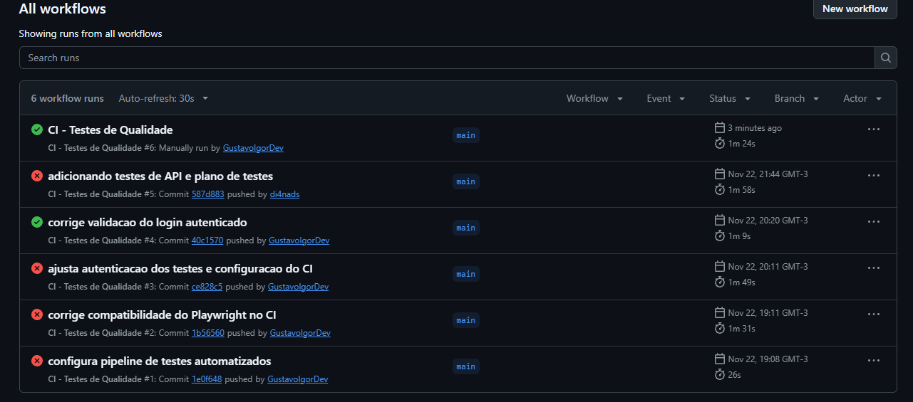
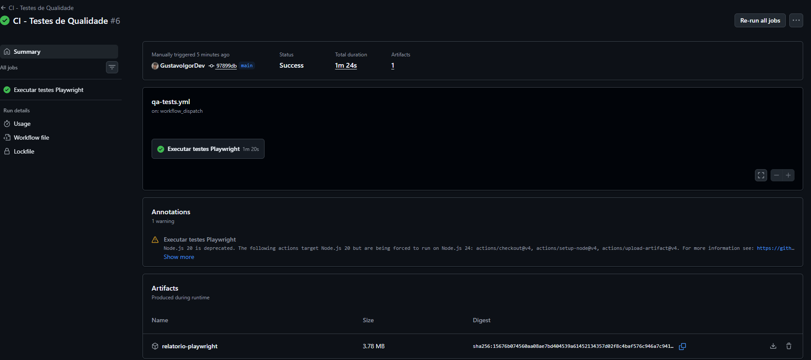

# Relatório de Integração Contínua (CI/CD)

## 1. Objetivo

Implementar um processo de integração contínua para automatizar a execução dos testes de qualidade do sistema Practice Software Testing, permitindo identificar falhas e possíveis regressões após alterações no repositório.

## 2. Ferramentas utilizadas

| Ferramenta | Finalidade |
|---|---|
| GitHub | Versionamento e armazenamento do código-fonte |
| GitHub Actions | Execução automatizada do pipeline |
| Playwright | Execução dos testes E2E e de API |
| TypeScript | Desenvolvimento dos testes automatizados |
| Node.js 22 | Ambiente de execução |
| Ubuntu 22.04 | Sistema operacional do ambiente de integração contínua |
| Chromium | Navegador utilizado nos testes de interface |

## 3. Configuração do pipeline

O pipeline foi configurado no arquivo `.github/workflows/qa-tests.yml`, disponível no repositório do projeto.

[Arquivo de configuração do pipeline](../../.github/workflows/qa-tests.yml)

O workflow recebeu o nome CI - Testes de Qualidade e possui um tempo limite de execução de 15 minutos.

### 3.1. Gatilhos de execução

| Gatilho | Comportamento |
|---|---|
| Push | Executa o pipeline quando alterações nos arquivos monitorados são enviadas à branch main |
| Pull Request | Executa o pipeline em solicitações de integração destinadas à branch main |
| Workflow Dispatch | Permite iniciar manualmente uma execução pela interface do GitHub |

Os arquivos monitorados para o evento de push são:

- tests/**
- playwright.config.ts
- package.json
- package-lock.json
- .github/workflows/qa-tests.yml

Essa configuração evita execuções desnecessárias quando são realizadas alterações exclusivamente na documentação. Alterações no código-fonte da aplicação também não disparam automaticamente o pipeline pelo evento de push na configuração atual.

## 4. Etapas do pipeline

| Etapa | Descrição |
|---|---|
| Checkout | Obtém o código do repositório |
| Configuração do Node.js | Prepara o ambiente de execução e o cache do npm |
| Instalação das dependências | Executa o comando npm ci |
| Instalação do Chromium | Instala o navegador e suas dependências |
| Execução dos testes | Executa os testes automatizados utilizando Playwright |
| Publicação do relatório | Disponibiliza o relatório HTML gerado pelo Playwright |
| Publicação das evidências de falhas | Disponibiliza os arquivos de diagnóstico quando ocorre uma falha e esses arquivos estão disponíveis |

O comando utilizado para executar os testes automatizados é:

`npx playwright test --project=chromium`

## 5. Gerenciamento de credenciais

As credenciais utilizadas nos testes de autenticação foram configuradas por meio do GitHub Secrets.

| Variável | Finalidade |
|---|---|
| TEST_USER_EMAIL | E-mail da conta utilizada nos testes |
| TEST_USER_PASSWORD | Senha da conta utilizada nos testes |

Essa abordagem permite disponibilizar as credenciais ao ambiente de execução sem armazenar seus valores diretamente no código-fonte versionado.

## 6. Quality Gate

O resultado da execução dos testes automatizados foi utilizado como critério de qualidade do pipeline.

| Critério | Comportamento esperado |
|---|---|
| Instalação das dependências | Deve ser concluída com sucesso |
| Preparação do ambiente | Deve ser concluída com sucesso |
| Execução dos testes automatizados | Todos os testes devem ser aprovados |
| Ocorrência de falhas | O pipeline deve apresentar status de falha |
| Relatório de execução | Deve ser disponibilizado quando gerado |

Caso algum teste seja reprovado, o comando de execução retorna um código de saída diferente de zero, fazendo com que o pipeline apresente status de falha.

Esse mecanismo permite identificar problemas automaticamente. O bloqueio obrigatório de merges dependeria de uma configuração adicional de proteção da branch.

## 7. Histórico de execuções

Durante o desenvolvimento do projeto, foram realizadas diferentes execuções do pipeline, permitindo identificar problemas e validar os ajustes implementados.

| Execução | Descrição | Resultado | Duração |
|---|---|---|---|
| #1 | Configuração inicial do pipeline | Falha | 26 s |
| #2 | Correção da compatibilidade do Playwright no CI | Falha | 1 min 31 s |
| #3 | Ajuste da autenticação e configuração do CI | Falha | 1 min 49 s |
| #4 | Correção da validação do login autenticado | Sucesso | 1 min 9 s |
| #5 | Adição dos testes de API e plano de testes | Falha | 1 min 58 s |
| #6 | Execução manual da versão atual | Sucesso | 1 min 24 s |

As falhas iniciais contribuíram para a identificação de problemas na configuração do ambiente e nos testes de autenticação.

Durante o desenvolvimento, também foram observadas dificuldades relacionadas à disponibilidade da conta utilizada para autenticação no ambiente público.

Após os ajustes realizados, uma nova execução manual foi concluída com sucesso.

**Evidência:**

## 8. Resultado da validação final

Em 23/11/2026, foi realizada uma execução manual do pipeline na branch main para validar a versão atual dos testes automatizados.

| Métrica | Resultado |
|---|---|
| Workflow | CI - Testes de Qualidade |
| Número da execução | 6 |
| Branch | main |
| Tipo de execução | Manual |
| Navegador configurado | Chromium |
| Casos automatizados previstos | 14 |
| Tempo total de execução | 1 minuto e 24 segundos |
| Resultado do pipeline | Sucesso |

O resultado demonstrou que a configuração de integração contínua permitiu executar a suíte automatizada em um ambiente independente da máquina utilizada durante o desenvolvimento.

A execução também gerou o artefato relatorio-playwright,
com tamanho de 3,78 MB, disponibilizando o relatório
dos testes automatizados.

Foi identificado um aviso relacionado à descontinuação
do Node.js 20 utilizado internamente pelas Actions.
O aviso não comprometeu o sucesso da execução.

**Evidência:**

## 9. Artefatos gerados

O pipeline foi configurado para disponibilizar os seguintes artefatos:

| Artefato | Conteúdo | Condição |
|---|---|---|
| relatorio-playwright | Relatório HTML dos testes automatizados | Tentativa de publicação independentemente do resultado da execução |
| evidencias-falhas | Arquivos de diagnóstico dos testes | Em caso de falha |

Os artefatos possuem um período de retenção de sete dias.

Essa configuração facilita a investigação de falhas e o acompanhamento dos resultados das execuções.

## 10. Escopo da integração contínua

O pipeline implementado contempla a integração contínua, com preparação do ambiente, instalação de dependências, execução dos testes automatizados e publicação de relatórios.

Não foi implementado um processo de entrega ou implantação contínua da aplicação.

A compilação do front-end Angular foi realizada separadamente no ambiente local durante a etapa de análise de qualidade e refatoração.

Os testes automatizados executados pelo pipeline utilizam o ambiente público do Practice Software Testing, não validando diretamente as alterações locais realizadas no código-fonte da aplicação.

## 11. Propostas de melhorias futuras

- Configurar a proteção da branch main utilizando o resultado do pipeline como verificação obrigatória.
- Incluir a compilação do front-end no pipeline.
- Incluir ferramentas de análise estática de código.
- Automatizar a coleta de métricas de cobertura de código.
- Ampliar a execução dos testes para Firefox e WebKit.
- Configurar um ambiente de testes independente do ambiente público.
- Incluir alterações no código-fonte da aplicação entre os gatilhos de execução.
- Implementar um processo de entrega contínua.

## 12. Conclusão

A implementação do pipeline permitiu automatizar a execução dos testes de qualidade utilizando GitHub Actions e Playwright.

O histórico de execuções demonstrou a evolução da configuração do ambiente e a importância da integração contínua na identificação de problemas durante o desenvolvimento.

A execução final bem-sucedida demonstrou a viabilidade da automação em um ambiente independente, estabelecendo uma base para futuras execuções de regressão.

A integração contínua contribui para a repetibilidade dos testes, a rastreabilidade dos resultados e a identificação antecipada de falhas.