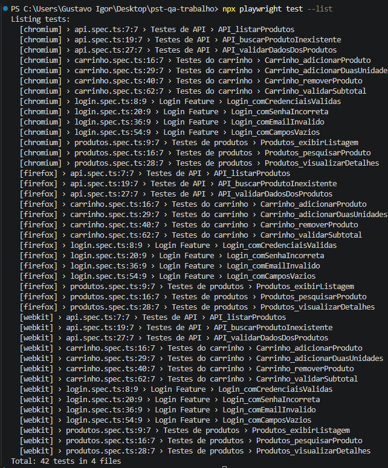
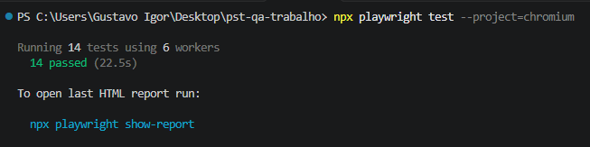
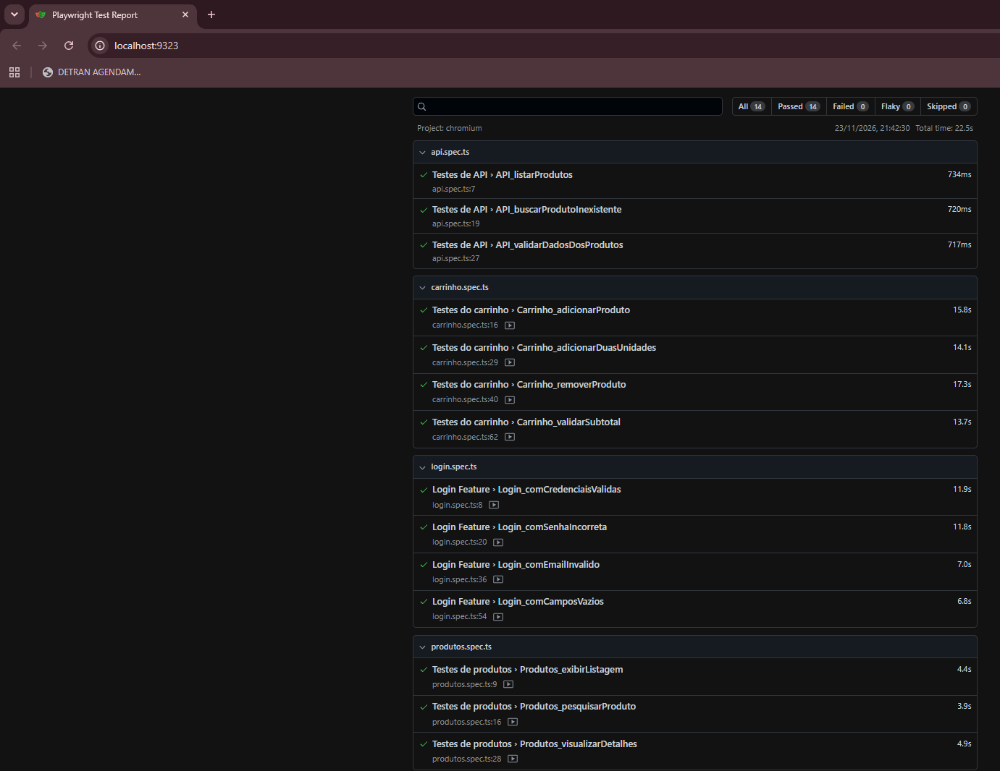

# Relatório de Cobertura de Testes

## 1. Objetivo

Apresentar a cobertura dos testes realizados no sistema Practice Software Testing, considerando as funcionalidades definidas no plano de testes, os riscos identificados e os cenários contemplados pelos testes manuais, exploratórios e automatizados.

## 2. Estratégia de cobertura

A estratégia de cobertura foi definida considerando os riscos associados às principais funcionalidades do sistema.

Foram utilizadas três abordagens complementares:

- Testes manuais estruturados.
- Testes exploratórios.
- Testes automatizados de interface e API.

A combinação dessas abordagens permitiu avaliar comportamentos esperados, entradas inválidas, regras de negócio e possíveis defeitos não previstos inicialmente.

## 3. Cobertura funcional

| Funcionalidade | Testes manuais | Testes exploratórios | Testes automatizados |
|---|---|---|---|
| Cadastro de usuários | Sim | Sim | Não |
| Autenticação | Sim | Sim | Sim |
| Listagem de produtos | Sim | Sim | Sim |
| Pesquisa de produtos | Sim | Sim | Sim |
| Detalhes de produtos | Sim | Não | Sim |
| Carrinho de compras | Sim | Sim | Sim |
| Filtros de produtos | Não | Sim | Não |
| Paginação | Não | Sim | Não |
| Comparação de produtos | Não | Sim | Não |
| Checkout | Não | Sim | Não |
| API de produtos | Não | Não | Sim |

Considerando as 11 áreas funcionais relacionadas na matriz, todas foram contempladas por pelo menos uma abordagem de teste.

| Métrica | Resultado |
|---|---|
| Áreas funcionais consideradas | 11 |
| Áreas funcionais testadas | 11 |
| Cobertura funcional das áreas consideradas | 100% |
| Áreas contempladas por automação | 6 |
| Cobertura de automação das áreas consideradas | 54,55% |

A cobertura de 100% refere-se exclusivamente às áreas funcionais relacionadas nesta matriz, não representando a totalidade dos requisitos, regras de negócio ou funcionalidades existentes no sistema.

## 4. Cobertura baseada em riscos

Os testes foram priorizados considerando os riscos identificados durante o planejamento.

| Risco associado | Pontuação | Manual | Exploratório | Automatizado |
|---|---:|---|---|---|
| Falhas na autenticação | 20 | Sim | Sim | Sim |
| Falhas no carrinho de compras | 16 | Sim | Sim | Sim |
| Falhas no cadastro de usuários | 12 | Sim | Sim | Não |
| Falhas na pesquisa de produtos | 9 | Sim | Sim | Sim |
| Falhas na visualização dos detalhes de produtos | 6 | Sim | Não | Sim |

Todos os cinco riscos relacionados foram contemplados por pelo menos uma abordagem de teste.

Os riscos de maior pontuação, relacionados à autenticação e ao carrinho de compras, também foram contemplados pelos testes automatizados, permitindo sua utilização em futuras execuções de regressão.

| Métrica | Resultado |
|---|---:|
| Riscos considerados | 5 |
| Riscos contemplados pelos testes | 5 |
| Cobertura dos riscos considerados | 100% |
| Riscos contemplados pela automação | 4 |
| Cobertura automatizada dos riscos considerados | 80% |

## 5. Cobertura dos testes manuais

Foram elaborados e executados 18 casos de testes manuais, distribuídos entre as principais funcionalidades do sistema.

| Funcionalidade | Quantidade |
|---|---:|
| Cadastro de usuários | 5 |
| Autenticação | 4 |
| Produtos | 4 |
| Carrinho de compras | 5 |
| Total | 18 |

Os testes contemplaram cenários positivos e negativos, validação de campos obrigatórios, entradas inválidas, pesquisa de produtos, gerenciamento de quantidades e cálculos do carrinho.

Os resultados individuais e as respectivas evidências estão disponíveis no documento:

[Casos de testes manuais](../testes-manuais/casos-de-teste.md)

## 6. Cobertura dos testes exploratórios

Foram realizadas duas sessões de testes exploratórios, totalizando 14 cenários investigados.

| Sessão | Área explorada | Cenários |
|---|---|---:|
| SE-001 | Cadastro e autenticação | 7 |
| SE-002 | Catálogo e carrinho de compras | 7 |
| Total | | 14 |

Os testes exploratórios complementaram os casos estruturados, permitindo investigar comportamentos relacionados às validações, filtros, paginação, comparação de produtos e checkout.

Os registros completos estão disponíveis no documento:

[Sessões exploratórias](../testes-exploratorios/sessoes-exploratorias.md)

## 7. Cobertura dos testes automatizados

A automação foi desenvolvida utilizando Playwright e TypeScript, contemplando testes de interface e testes de API.

### 7.1. Distribuição dos testes

| Arquivo | Tipo | Quantidade | Percentual |
|---|---|---:|---:|
| login.spec.ts | E2E | 4 | 28,57% |
| produtos.spec.ts | E2E | 3 | 21,43% |
| carrinho.spec.ts | E2E | 4 | 28,57% |
| api.spec.ts | API | 3 | 21,43% |
| Total | | 14 | 100% |

### 7.2. Cenários automatizados

| Teste | Funcionalidade validada |
|---|---|
| Login_comCredenciaisValidas | Autenticação com credenciais válidas |
| Login_comSenhaIncorreta | Rejeição de senha incorreta |
| Login_comEmailInvalido | Validação de e-mail inválido |
| Login_comCamposVazios | Validação de campos obrigatórios |
| Produtos_exibirListagem | Exibição da listagem de produtos |
| Produtos_pesquisarProduto | Pesquisa de produtos |
| Produtos_visualizarDetalhes | Visualização dos detalhes de um produto |
| Carrinho_adicionarProduto | Adição de produto ao carrinho |
| Carrinho_adicionarDuasUnidades | Gerenciamento de quantidade |
| Carrinho_removerProduto | Remoção de produto |
| Carrinho_validarSubtotal | Validação do cálculo do subtotal |
| API_listarProdutos | Listagem de produtos pela API |
| API_buscarProdutoInexistente | Consulta de produto inexistente |
| API_validarDadosDosProdutos | Validação dos dados retornados pela API |

### 7.3. Configuração de navegadores

O Playwright foi configurado para permitir a execução dos testes em três mecanismos de navegador.

| Projeto | Instâncias de testes configuradas |
|---|---:|
| Chromium | 14 |
| Firefox | 14 |
| WebKit | 14 |
| Total | 42 |

O comando utilizado para verificar a quantidade de testes configurados foi:

`npx playwright test --list`

O resultado apresentou 42 instâncias de testes distribuídas em quatro arquivos, correspondentes aos 14 casos distintos configurados para os três projetos.

A listagem não representa a execução efetiva dos testes em todos os navegadores.

**Evidência:**

### 7.4. Resultados da execução

Em 23/11/2026, às 21h42, foi realizada uma execução local
dos testes automatizados utilizando Chromium, por meio
do comando:

`npx playwright test --project=chromium`

| Métrica | Resultado |
|---|---:|
| Testes executados | 14 |
| Testes aprovados | 14 |
| Testes reprovados | 0 |
| Testes instáveis (flaky) | 0 |
| Testes ignorados | 0 |
| Taxa de aprovação | 100% |
| Tempo total de execução | 22,5 segundos |
| Workers utilizados | 6 |

A taxa de aprovação representa o percentual de testes
executados com sucesso, não correspondendo ao percentual
de cobertura do código-fonte.

**Evidências:**

### 7.5. Testes de regressão

Os testes automatizados foram desenvolvidos para permitir a execução recorrente dos principais cenários relacionados à autenticação, aos produtos, ao carrinho de compras e à API.

A utilização do Playwright em conjunto com o GitHub Actions permite repetir esses testes após alterações no repositório, auxiliando na identificação de possíveis regressões no ambiente testado.

Como os testes automatizados utilizam o ambiente público do Practice Software Testing, sua execução não valida diretamente as alterações locais realizadas no código-fonte durante a refatoração.

### 7.6. Mocks e stubs

Não foram utilizados mocks ou stubs nos testes automatizados desenvolvidos por nós.

Os testes foram realizados diretamente contra o ambiente público e sua API, buscando avaliar o comportamento real do sistema e a integração entre seus componentes.

Essa abordagem apresenta dependência da disponibilidade e do estado do ambiente externo.

## 8. Cobertura de código

A cobertura de código representa a proporção de linhas, instruções, funções ou ramificações executadas durante os testes.

Neste projeto, os testes automatizados foram direcionados principalmente à validação funcional do sistema disponibilizado publicamente.

Não foi realizada a instrumentação do código-fonte para coletar métricas de cobertura estrutural.

| Métrica | Resultado |
|---|---|
| Cobertura de linhas | Não mensurada |
| Cobertura de instruções | Não mensurada |
| Cobertura de funções | Não mensurada |
| Cobertura de ramificações | Não mensurada |

Como proposta de evolução, recomenda-se a implementação de testes unitários e a utilização de ferramentas de cobertura, como Karma Coverage para o front-end Angular e PHPUnit com suporte à coleta de cobertura para o back-end PHP.

## 9. Resumo geral

| Indicador | Resultado |
|---|---:|
| Casos de testes manuais executados | 18 |
| Sessões exploratórias realizadas | 2 |
| Cenários exploratórios investigados | 14 |
| Casos de testes automatizados distintos | 14 |
| Testes automatizados E2E | 11 |
| Testes automatizados de API | 3 |
| Instâncias automatizadas configuradas | 42 |
| Testes automatizados aprovados na execução local registrada | 14 |
| Taxa de aprovação da execução automatizada registrada | 100% |
| Cobertura das áreas funcionais consideradas | 100% |
| Cobertura automatizada das áreas funcionais consideradas | 54,55% |
| Cobertura dos riscos considerados | 100% |
| Cobertura automatizada dos riscos considerados | 80% |
| Defeitos registrados | 6 |

## 10. Oportunidades de ampliação da cobertura

- Automatizar os cenários de cadastro de usuários.
- Automatizar os testes de filtros, paginação e comparação de produtos.
- Automatizar o fluxo completo de checkout.
- Implementar testes unitários para as regras de validação.
- Ampliar os testes de API.
- Coletar métricas de cobertura de código.
- Executar e registrar os resultados dos testes nos três navegadores configurados.
- Configurar testes de regressão diretamente contra uma instância local da aplicação modificada.

## 11. Conclusão

A estratégia adotada permitiu contemplar as principais áreas funcionais e os riscos considerados no planejamento do projeto.

Os testes manuais e exploratórios contribuíram para a identificação de defeitos e inconsistências, enquanto os testes automatizados estabeleceram uma base para futuras execuções de regressão.

Apesar da cobertura funcional obtida, existem oportunidades de ampliação da automação e de implementação de métricas de cobertura estrutural.

A combinação das diferentes abordagens contribuiu para uma avaliação mais abrangente da qualidade do sistema dentro do escopo definido.