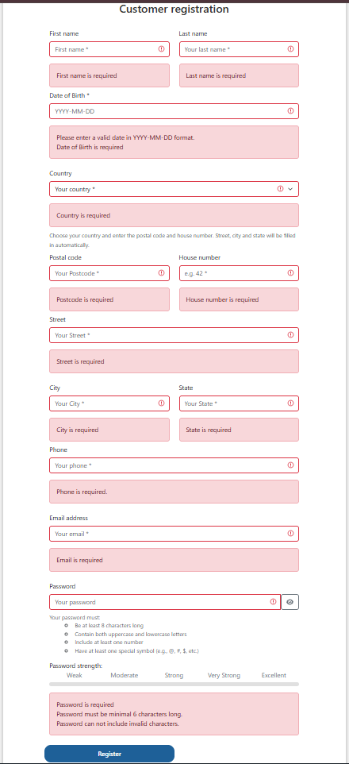
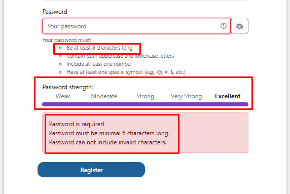
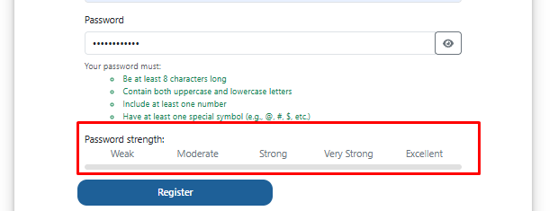
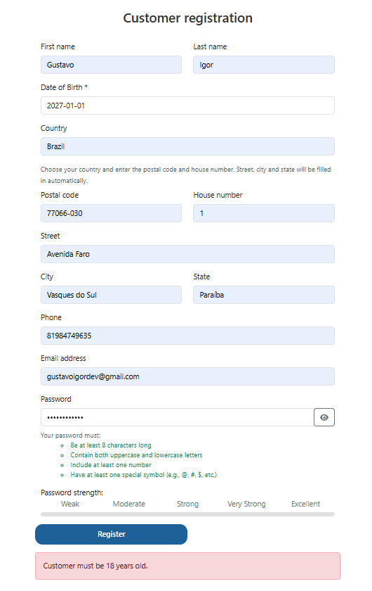
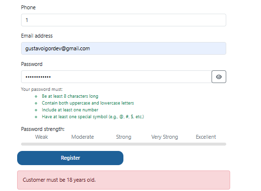
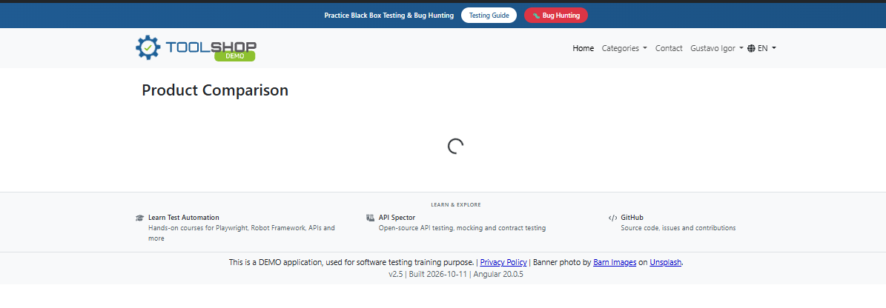

# Relatório de Defeitos

**Sistema:** Practice Software Testing  
**Responsável:** Gustavo Igor  
**Revisora:** Diana da Silva      
**Ambiente:** Google Chrome - site público

## 1. Objetivo

Documentar os defeitos achados durante a execução dos testes manuais e exploratórios, os classificando de acordo com sua severidade e prioridade de correção.

## 2. Classificação dos defeitos

A severidade representa o impacto do defeito no funcionamento do sistema, enquanto a prioridade representa a urgência de sua correção.

| ID | Defeito | Severidade | Prioridade | Status |
|---|---|---|---|---|
| DEF-001 | Divergência nas informações sobre o tamanho mínimo da senha | Baixa | Média | Aberto |
| DEF-002 | Funcionamento inconsistente do indicador de força da senha | Baixa | Média | Aberto |
| DEF-003 | Mensagem incorreta na validação de caracteres especiais da senha | Baixa | Média | Aberto |
| DEF-004 | Mensagem pouco específica para data de nascimento futura | Baixa | Baixa | Aberto |
| DEF-005 | Ausência de validação adequada do telefone | Média | Média | Aberto |
| DEF-006 | Tela de comparação de produtos permanece em carregamento | Média | Alta | Aberto |

## 3. Detalhamento dos defeitos

### DEF-001 - Divergência nas informações sobre o tamanho mínimo da senha

**Funcionalidade:** Cadastro de usuários.

**Severidade:** Baixa.

**Prioridade:** Média.

**Status:** Aberto.

**Passos para reprodução:**

1. Acessar a página de cadastro.
2. Manter o campo Password vazio.
3. Clicar no botão Register.
4. Comparar a mensagem de validação com os requisitos apresentados abaixo do campo.

**Resultado esperado:** As instruções e mensagens de validação devem apresentar a mesma quantidade mínima de caracteres.

**Resultado obtido:** As instruções informam que a senha deve possuir pelo menos 8 caracteres, enquanto a mensagem de validação informa um mínimo de 6 caracteres.

**Impacto:** O usuário recebe informações conflitantes sobre os requisitos necessários para criação da senha.

**Evidência:** 

 

### DEF-002 - Funcionamento inconsistente do indicador de força da senha

**Funcionalidade:** Cadastro de usuários.

**Severidade:** Baixa.

**Prioridade:** Média.

**Status:** Aberto.

**Frequência:** Intermitente.

**Passos para reprodução:**

1. Acessar a página de cadastro.
2. Preencher o campo Password com uma senha classificada como Excellent.
3. Alterar ou excluir a senha informada.
4. Observar o indicador de força da senha.
5. Repetir o preenchimento e verificar se o indicador é atualizado.

**Resultado esperado:** O indicador deve apresentar a força correspondente à senha atualmente informada e ser reiniciado quando o campo estiver vazio.

**Resultado obtido:** Em algumas tentativas, o indicador permaneceu classificado como Excellent mesmo após a exclusão da senha. Durante os testes exploratórios, também foi observado que o indicador não apresentou nenhuma classificação mesmo com uma senha preenchida que atendia aos requisitos.

**Impacto:** O usuário pode receber informações incorretas sobre a força da senha utilizada.

**Evidência:** 

 
 

### DEF-003 - Mensagem incorreta na validação de caracteres especiais da senha

**Funcionalidade:** Cadastro de usuários.

**Severidade:** Baixa.

**Prioridade:** Média.

**Status:** Aberto.

**Passos para reprodução:**

1. Acessar a página de cadastro.
2. Preencher os campos obrigatórios com informações válidas.
3. Informar uma senha que atenda aos demais requisitos, mas não possua caracteres especiais.
4. Clicar no botão Register.
5. Observar a mensagem de validação.

**Resultado esperado:** O sistema deve impedir o cadastro e informar que a senha precisa possuir pelo menos um caractere especial.

**Resultado obtido:** O sistema impede o cadastro, porém apresenta a mensagem "Password can not include invalid characters", indicando a presença de caracteres inválidos em vez da ausência de um caractere obrigatório.

**Impacto:** A mensagem apresentada dificulta a identificação e a correção do requisito não atendido.

**Evidência:** 
 

### DEF-004 - Mensagem pouco específica para data de nascimento futura

**Funcionalidade:** Cadastro de usuários.

**Severidade:** Baixa.

**Prioridade:** Baixa.

**Status:** Aberto.

**Passos para reprodução:**

1. Acessar a página de cadastro.
2. Preencher o campo Date of Birth com uma data futura.
3. Preencher os demais campos obrigatórios.
4. Clicar no botão Register.

**Resultado esperado:** O sistema deve impedir o cadastro e apresentar uma mensagem específica informando que a data de nascimento não pode ser futura, e próxima ao campo.

**Resultado obtido:** O sistema impede o cadastro, porém apresenta uma mensagem genérica ao final do formulário, informando que o cliente deve possuir pelo menos 18 anos.

**Impacto:** A mensagem não identifica diretamente o problema com a data informada.

**Evidência:**

 

### DEF-005 - Ausência de validação adequada do telefone

**Funcionalidade:** Cadastro de usuários.

**Severidade:** Média.

**Prioridade:** Média.

**Status:** Aberto.

**Passos para reprodução:**

1. Acessar a página de cadastro.
2. Preencher o campo Phone com apenas um dígito.
3. Preencher os demais campos obrigatórios com informações válidas.
4. Clicar no botão Register.
5. Verificar se o cadastro é impedido devido ao telefone inválido.

**Resultado esperado:** O sistema deve validar o número de telefone informado e impedir o cadastro quando o valor não possuir um formato válido.

**Resultado obtido:** Durante a exploração, o campo permitiu o preenchimento de apenas um dígito sem apresentar uma mensagem específica de validação.

**Impacto:** O sistema permite o cadastro de usuários com números de telefone inválidos.

**Evidência:**

 

### DEF-006 - Tela de comparação de produtos permanece em carregamento

**Funcionalidade:** Comparação de produtos.

**Severidade:** Média.

**Prioridade:** Alta.

**Status:** Aberto.

**Passos para reprodução:**

1. Acessar o catálogo de produtos.
2. Selecionar produtos para comparação.
3. Acessar a tela Product Comparison.
4. Aguardar o carregamento das informações.

**Resultado esperado:** O sistema deve apresentar as informações dos produtos selecionados, permitindo sua comparação.

**Resultado obtido:** Durante a execução do teste exploratório, a tela permaneceu em carregamento, sem apresentar as informações dos produtos.

**Impacto:** O comportamento impede a utilização da funcionalidade de comparação, dificultando a escolha de produtos pelo usuário.

**Observação:** A frequência em que ocorre ainda precisa ser confirmada.

**Evidência:** 

 

## 4. Conclusão

Durante a execução dos testes manuais e exploratórios, foram registrados seis apontamentos relacionados à qualidade do sistema, incluindo defeitos funcionais, inconsistências nas mensagens de validação, oportunidades de melhoria na interface.

A maior parte dos problemas encontrados está relacionada ao formulário de cadastro. O problema na comparação de produtos recebeu prioridade alta por impedir a utilização da funcionalidade durante a execução realizada.
