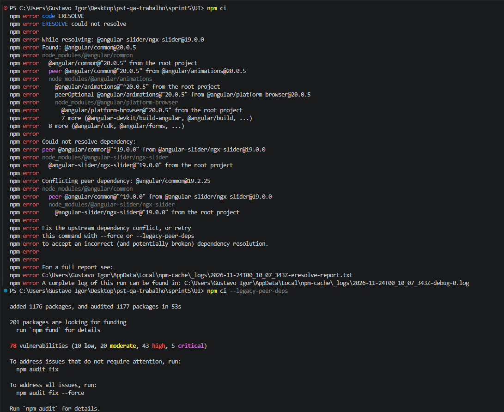
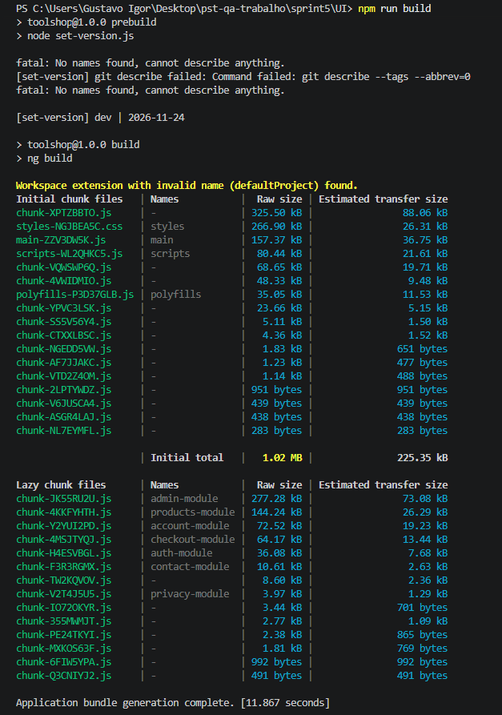
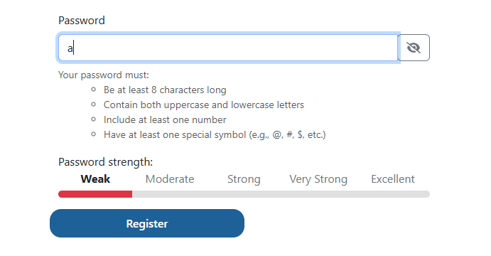
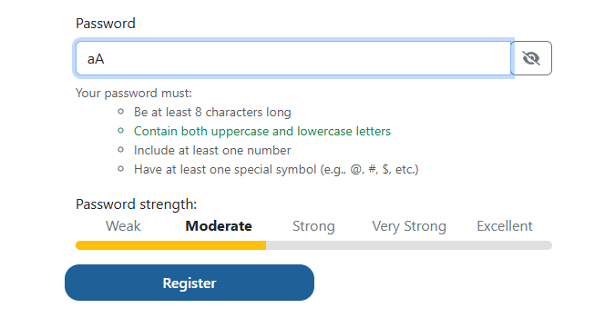
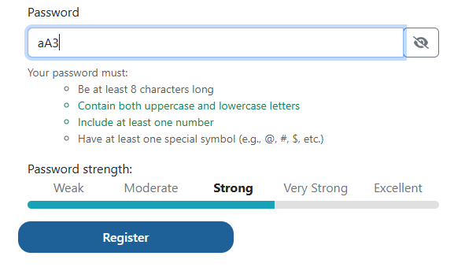
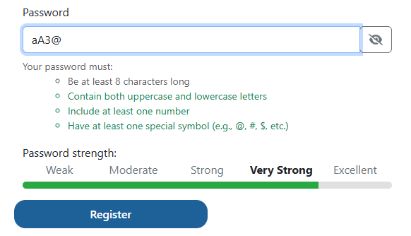
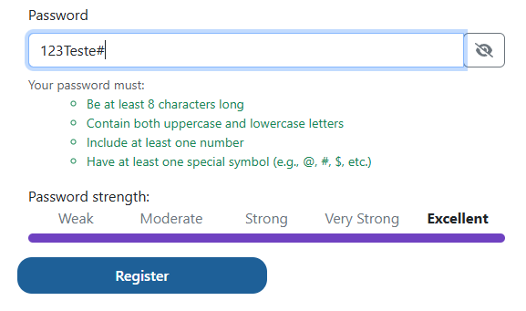

# Relatório de Análise de Qualidade e Refatoração

## 1. Objetivo

Avaliar a qualidade interna do código-fonte do sistema Practice Software Testing, identificando problemas de manutenibilidade, duplicação de código, inconsistências nas validações e oportunidades de melhoria.

A análise foi realizada na versão Sprint 5 do projeto, com foco na funcionalidade de cadastro de usuários, considerando os defeitos identificados durante os testes manuais e exploratórios.

## 2. Metodologia

A análise de qualidade foi realizada por meio das seguintes atividades:

- Inspeção estática manual do código-fonte.
- Análise das regras de validação do front-end e do back-end.
- Identificação de code smells.
- Investigação das possíveis causas dos defeitos encontrados.
- Análise das dependências do projeto.
- Implementação de refatorações.
- Compilação do front-end após as alterações.
- Validação funcional da melhoria implementada.

## 3. Arquivos analisados

| Arquivo | Responsabilidade |
|---|---|
| password.validators.ts | Regras de validação de senhas |
| register.component.ts | Gerenciamento do formulário de cadastro |
| register.component.html | Interface do formulário de cadastro |
| password-input.component.ts | Comportamento do componente de entrada de senha |
| password-input.component.html | Interface do campo de senha |
| StoreCustomer.php | Validação dos dados de cadastro no back-end |
| package.json | Gerenciamento das dependências do front-end |

## 4. Code Smells identificados

### CS-001: Código duplicado

**Localização:** password.validators.ts e register.component.ts.

**Descrição:** As regras utilizadas para validar a senha também estavam presentes no método responsável por calcular sua força, ocasionando duplicação de lógica.

**Impacto:** Uma alteração nas regras de validação poderia exigir modificações em diferentes arquivos, aumentando o risco de inconsistências.

**Solução:** Centralizar o cálculo da força da senha na classe PasswordValidators, reutilizando os validadores existentes sempre que possível.

**Status:** Refatoração implementada.

### CS-002: Número mágico 
**Localização:** register.component.ts.

**Descrição:** O valor numérico 8, correspondente ao comprimento mínimo da senha, estava definido diretamente na configuração do formulário e no método de cálculo da força da senha.

**Impacto:** Dificuldade de manutenção e possibilidade de divergência entre as regras.

**Solução:** Criar a constante MIN_LENGTH na classe PasswordValidators e utilizá-la nas duas operações.

**Status:** Refatoração implementada no código TypeScript analisado.

### CS-003: Importação redundante

**Localização:** register.component.ts.

**Descrição:** O módulo ReactiveFormsModule estava declarado duas vezes na lista de imports do componente.

**Impacto:** Redundância desnecessária, prejudicando a organização e a legibilidade do código.

**Solução:** Remover a declaração duplicada, mantendo apenas uma ocorrência do módulo.

**Status:** Refatoração implementada.

### CS-004: Excesso de responsabilidades

**Localização:** register.component.ts.

**Descrição:** O componente de cadastro concentrava diferentes responsabilidades, incluindo configuração do formulário, validações, cálculo da força da senha, consulta de endereço, envio dos dados e tratamento de erros.

**Impacto:** Maior complexidade de manutenção e dificuldade na realização de testes isolados.

**Solução:** Transferir a lógica de cálculo da força da senha para a classe PasswordValidators e propor a separação gradual das demais responsabilidades.

**Status:** Refatoração parcial implementada.

## 5. Análise das possíveis causas dos defeitos

Durante a inspeção do código-fonte, foram identificados comportamentos que podem estar relacionados aos defeitos registrados nas etapas anteriores do projeto.

| Defeito | Análise técnica |
|---|---|
| DEF-001 | O front-end e o back-end estabelecem o comprimento mínimo de oito caracteres para a senha. A divergência observada na mensagem de erro indica uma possível inconsistência nos textos de validação. |
| DEF-002 | O formulário atualizava o valor da senha ao perder o foco, enquanto o indicador de força era acionado durante a digitação. Essa diferença poderia fazer com que o indicador utilizasse um valor desatualizado. |
| DEF-003 | Diferentes regras de validação da senha compartilhavam uma mesma mensagem de erro, dificultando a identificação do requisito não atendido. |
| DEF-005 | A expressão regular utilizada na validação do telefone aceitava sequências numéricas com apenas um dígito. O back-end também não estabelecia um comprimento mínimo para esse campo. |

As análises representam possíveis causas identificadas na versão Sprint 5 do código-fonte, não sendo confirmada a correspondência exata entre essa versão e a versão disponibilizada no ambiente público.

## 6. Refatoração implementada

A melhoria selecionada foi a reorganização das regras de validação de senha e a correção do comportamento do indicador de força, relacionado ao DEF-002.

Foram modificados três arquivos.

### 6.1. password.validators.ts

- Criação da constante MIN_LENGTH.
- Implementação do método strength.
- Centralização do cálculo da força da senha.
- Reutilização dos validadores de comprimento, números e caracteres especiais.

### 6.2. register.component.ts

- Remoção da declaração duplicada do ReactiveFormsModule.
- Utilização da constante MIN_LENGTH.
- Substituição da lógica interna de cálculo da força da senha pela chamada ao método strength.
- Alteração da configuração do campo de senha de updateOn: 'blur' para updateOn: 'change'.
- Utilização de valueChanges para atualizar o indicador de força sempre que o valor da senha for alterado.

### 6.3. register.component.html

- Remoção do evento input anteriormente utilizado para atualizar o indicador de força da senha.

A refatoração buscou melhorar a manutenibilidade do código, enquanto a correção funcional buscou garantir a atualização imediata do indicador durante a digitação.

## 7. Métricas comparativas

| Métrica | Antes | Depois |
|---|---:|---:|
| Declarações redundantes de módulos no componente | 1 | 0 |
| Definições numéricas do comprimento mínimo da senha nos arquivos TypeScript analisados | 2 | 1 |
| Duplicações das expressões regulares de números e símbolos | 2 | 0 |
| Locais de implementação do cálculo da força da senha | Componente de cadastro | Classe de validadores |
| Atualização do valor do campo de senha | Ao perder o foco | Durante a digitação |

As métricas foram obtidas por meio da comparação manual do código-fonte antes e depois das alterações.

O comando git diff --stat apresentou os seguintes resultados:

| Métrica | Resultado |
|---|---:|
| Arquivos modificados | 3 |
| Linhas adicionadas | 99 |
| Linhas removidas | 65 |
| Problemas de formatação identificados pelo git diff --check | 0 |

## 8. Análise das dependências

Durante a preparação do ambiente local, foi identificado um conflito entre as versões das dependências do projeto.

O projeto utilizava Angular 20.0.5, enquanto a biblioteca ngx-slider, na versão 19.0.0, declarava compatibilidade com Angular 19.

O conflito impediu a instalação inicial das dependências utilizando o comando npm ci.

Como solução temporária, foi utilizado o seguinte comando:

`npm ci --legacy-peer-deps`

A instalação foi concluída sem necessidade de modificar as versões das dependências. Entretanto, essa solução não garante a compatibilidade entre todas as bibliotecas.

### 8.1. Vulnerabilidades identificadas

Durante a instalação, o npm reportou 78 vulnerabilidades nas dependências do projeto.

| Severidade | Quantidade |
|---|---:|
| Baixa | 10 |
| Moderada | 20 |
| Alta | 43 |
| Crítica | 5 |
| Total | 78 |

Esses resultados indicam a necessidade de uma revisão das dependências utilizadas pelo sistema.

Não foram realizadas atualizações automáticas das bibliotecas, pois essas alterações poderiam introduzir incompatibilidades e estavam fora do escopo da refatoração selecionada.

Os resultados representam vulnerabilidades reportadas pelo npm, não sendo realizada uma investigação individual sobre sua possibilidade de exploração no sistema.

**Evidência:**

## 9. Validação da compilação

Após a implementação das alterações, foi realizada a compilação do front-end utilizando o comando:

`npm run build`

A compilação foi concluída com sucesso, permitindo verificar que as alterações realizadas não impediram a geração do build da aplicação.

| Métrica | Resultado |
|---|---|
| Versão do Node.js | 24.14.1 |
| Versão do npm | 11.11.0 |
| Pacotes instalados | 1.176 |
| Tempo de instalação | 53 segundos |
| Tempo de geração do bundle | 11,867 segundos |
| Tamanho inicial do bundle | 1,02 MB |
| Tamanho estimado de transferência | 225,35 kB |
| Resultado da compilação | Aprovado |

### 9.1. Avisos identificados

Apesar da compilação bem-sucedida, foram identificados problemas técnicos que representam oportunidades de melhoria.

| Problema | Impacto |
|---|---|
| Bundle inicial acima do orçamento de 500 kB | Possível aumento do tempo de carregamento da aplicação |
| Arquivos CSS acima do orçamento configurado | Necessidade de revisão e otimização dos estilos |
| Utilização de funções descontinuadas do Sass | Possíveis incompatibilidades em atualizações futuras |
| Dependência qrcode não utiliza ESM | Possíveis limitações na otimização do build |
| Ausência de tags Git no repositório local | Dificuldade na identificação automática da versão da aplicação |

**Evidência:**

## 10. Validação funcional da melhoria

Após a compilação, o front-end foi executado localmente utilizando o comando:

`npx ng serve`

A tela de cadastro foi acessada para verificar o comportamento do indicador de força da senha após as alterações.

### 10.1. Critérios de aceitação

- O indicador deve ser atualizado durante a digitação.
- A atualização não deve depender da perda de foco do campo.
- A classificação deve corresponder aos requisitos atendidos pela senha.
- A remoção completa da senha deve retornar o indicador a 0%.
- O front-end deve continuar sendo compilado normalmente.

### 10.2. Resultados dos testes

| Entrada | Resultado esperado | Resultado obtido | Status |
|---|---|---|---|
| a | Weak | Weak | Aprovado |
| aA | Moderate | Moderate | Aprovado |
| aA3 | Strong | Strong | Aprovado |
| aA3@ | Very Strong | Very Strong | Aprovado |
| 123Teste# | Excellent | Excellent | Aprovado |
| Campo vazio após apagar a senha | Indicador em 0% | Indicador em 0% | Aprovado |
| Alteração da senha durante a digitação | Atualização imediata | Atualização imediata | Aprovado |

A validação funcional apresentou resultados satisfatórios nos cenários executados, demonstrando que o indicador passou a acompanhar as alterações realizadas no campo de senha.

A correção foi validada no ambiente local, sem publicação no ambiente público. Os testes não envolveram o envio completo do formulário para o back-end.

**Evidência:**

## 11. Análise de impacto das alterações

| Funcionalidade | Impacto esperado | Validação |
|---|---|---|
| Indicador de força da senha | Atualização imediata durante a digitação | Validado localmente |
| Regras de validação da senha | Preservação dos requisitos existentes | Validação parcial nos cenários executados |
| Cadastro de usuários | Preservação da estrutura de envio dos dados | Inspeção do código |
| Consulta automática de endereço | Nenhuma alteração funcional prevista | Inspeção do código |
| Compilação do front-end | Preservação da capacidade de geração do build | Validado localmente |

A alteração foi concentrada na funcionalidade de cadastro, buscando minimizar impactos nas demais funcionalidades do sistema.

## 12. Propostas de melhorias futuras

| Melhoria proposta | Benefício | Prioridade sugerida |
|---|---|---|
| Revisar as dependências com vulnerabilidades críticas e altas | Aumento da segurança | Alta |
| Atualizar as dependências incompatíveis | Melhoria na estabilidade do ambiente | Alta |
| Implementar validações mais completas para números de telefone | Melhoria na integridade dos dados | Média |
| Individualizar as mensagens de erro da senha | Melhoria na usabilidade | Média |
| Corrigir as mensagens divergentes sobre o comprimento mínimo da senha | Consistência das informações | Média |
| Implementar testes unitários específicos para os validadores | Prevenção de regressões | Média |
| Otimizar o tamanho do bundle | Melhoria no desempenho | Média |
| Separar as responsabilidades do componente de cadastro | Melhoria na manutenibilidade | Média |
| Substituir funções descontinuadas do Sass | Redução da dívida técnica | Baixa |

## 13. Conclusão

A análise de qualidade permitiu identificar problemas relacionados à duplicação de código, organização das responsabilidades, gerenciamento de dependências e inconsistências nas validações do sistema.

A refatoração implementada reduziu redundâncias, centralizou parte das regras de senha e corrigiu o comportamento do indicador de força nos cenários testados localmente.

A compilação bem-sucedida e os testes funcionais realizados forneceram evidências da viabilidade técnica da melhoria.

Além disso, foram identificadas oportunidades de evolução relacionadas à segurança, ao desempenho, à manutenibilidade e à experiência do usuário.

Os resultados demonstram a importância de combinar testes funcionais, inspeção de código e análise de métricas durante o processo de garantia da qualidade de software.