# Sessões de Testes Exploratórios

**Sistema:** Practice Software Testing  
**Executor:** Gustavo Igor  
**Revisora:** Diana da Silva    
**Data:** 23/11/2026  
**Ambiente:** Google Chrome - site público

## 1. Objetivo

Investigar comportamentos não contemplados integralmente pelos casos de teste estruturados, buscando identificar falhas funcionais, inconsistências de interface e problemas de validação.

## 2. Sessão SE-001 - Cadastro e autenticação

**Charter:** Explorar as funcionalidades de cadastro e autenticação utilizando diferentes combinações de dados válidos, inválidos e valores-limite para identificar inconsistências nas validações e no gerenciamento da sessão do usuário.

**Duração prevista:** 30 minutos.

**Horário de início:** 18:50

**Horário de término:** 19:25

**Duração real:** 35 minutos

**Áreas investigadas:**

- Cadastro de usuários.
- Validação de dados pessoais.
- Validação e força da senha.
- Preenchimento de endereço.
- Autenticação e encerramento de sessão.

### Registro da exploração

| Cenário investigado | Comportamento observado | Evidência | Defeito relacionado |
|---|---|---|---|
| Data de nascimento futura é aceita? | O sistema não permite o cadastro pois o cliente deve ter no minímo 18 anos, porém o aviso deveria ser abaixo do campo assim que fosse preenchida uma data futura | 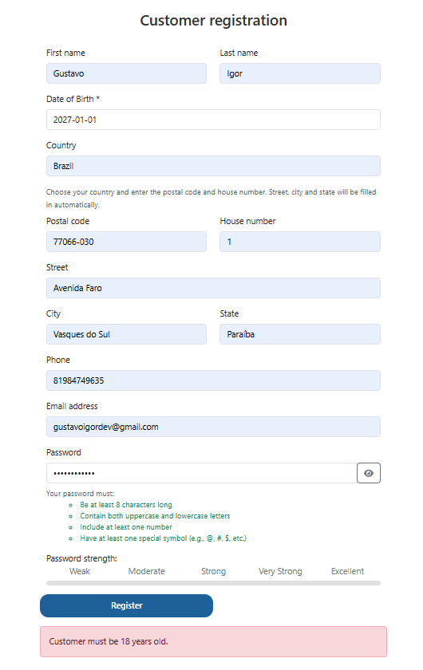 | DEF-004 |
| Fora o erro já encontrado nos casos de teste, o password strengh funciona corretamente? | O funcionanmento é inconsistente, dessa vez a senha foi preenchida cumprindo todos os requisitos e a barra da funcionalidade nem se moveu | 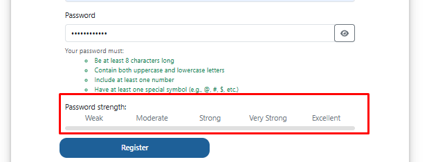 | DEF-002 |
| Número de telefone está sendo validado? | Apesar de ser um campo obrigatório e necessário, o sistema não avalia se um número é válido ou não | 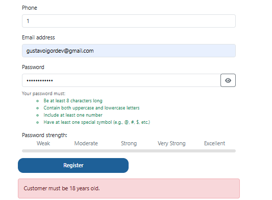 | DEF-005 |
| Preencher o CEP autocompleta os demais campos de endereço? | Sim, preencher o campo Postal Code autopreenche os demais campos | | |
| O campo de nome segue o limite de caracteres? | Sim, ao preencher First Name com mais de 40 caracteres uma mensagem de erro é exibida e o usuário não é cadastrado |  | |
| O campo sobrenome segue o limite de caracteres? | Sim, ao preencher Last Name com mais de 20 caracteres uma mensagem de erro é exibida e o usuário não é cadastrado | 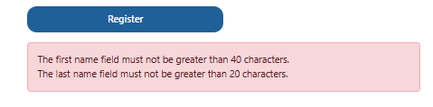 | |
| O campo telefone segue o limite de caracteres? | Sim, apesar do sistema não verificar se um número é válido, ele verifica se o número tem mais do que 24 caracteres e não prossegue com o cadastro caso ultrapasse esse limite |  | |

### Defeitos identificados

DEF-002: Funcionamento inconsistente do indicador de força da senha, que em alguns momentos não apresenta nenhuma classificação mesmo com a senha preenchida.

DEF-004: Ausência de validação imediata e exclusiva para datas de nascimento futuras.

DEF-005: Possível ausência de validação adequada do número de telefone, necessitando de confirmação como os outros campos válidos.

### Conclusão da sessão

Durante a sessão foi possível verificar que o sistema possui validações de obrigatoriedade e de limite de caracteres nos campos do formulário de cadastro. O preenchimento automático dos campos de endereço também funcionou durante a execução.

Porém, foram acahadas inconsistências na validação dos dados pessoais e no funcionamento do indicador de força da senha. Esses comportamentos podem dificultar o preenchimento correto do formulário pelo usuário.

## 3. Sessão SE-002 - Catálogo e carrinho

**Charter:** Explorar o catálogo e o carrinho de compras utilizando diferentes pesquisas, combinações de filtros e quantidades de produtos para identificar falhas na apresentação das informações, nas validações e nos cálculos.

**Duração prevista:** 30 minutos.

**Horário de início:** 19:30

**Horário de término:** 20:20

**Duração real:** 50 minutos

**Áreas investigadas:**

- Pesquisa de produtos.
- Filtros e ordenação.
- Disponibilidade de produtos.
- Efetivação da compra a partir do carrinho.

### Registro da exploração

| Cenário investigado | Comportamento observado | Evidência | Defeito relacionado |
|---|---|---|---|
| Os filtros de categoria da barra de navegação funcionam? | Sim, o sistema permite filtrar por categoria normalmente utilizando o filtro da barra de navegação | 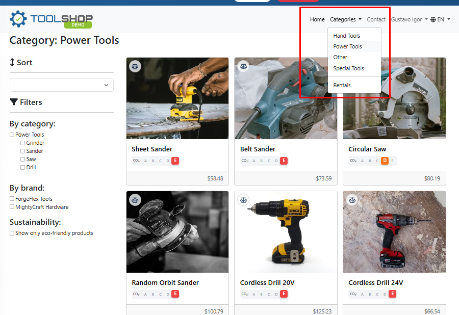 | |
| Em caso dos filtros de categoria da barra de navegação funcionare, eles exibem os produtos corretamente de acordo com o que foi selecionado? | Sim, o sistema exibe no catalogo exatamente o tipo de produto que foi selecionado | 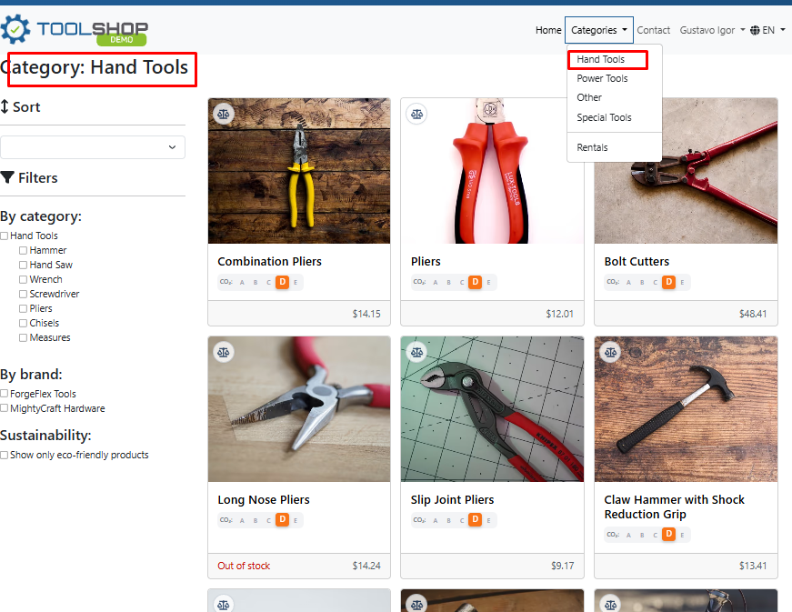 | |
| O filtro de range de preço funciona corretamente? | Sim, o sistema filtra e exibe corretamente apenas os produtos dentro do range de preço definido no filtro | 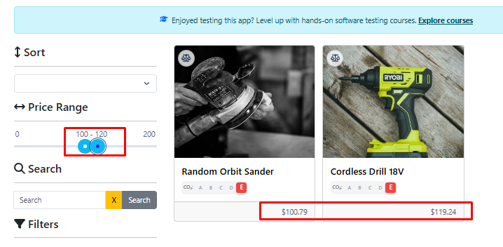 | |
| O filtro de categoria da barra lateral funciona corretamente? | Sim, assim como o filtro de categoria da barra de navegação, o filtro da barra lateral funciona como o esperado retornando apenas os produtos relacionados com a categoria marcada | 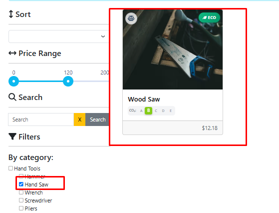 | |
| A paginação do catalogo funciona corretamente? | Sim, o usuário consegue navegar entre as páginas do catálogo normalmente | 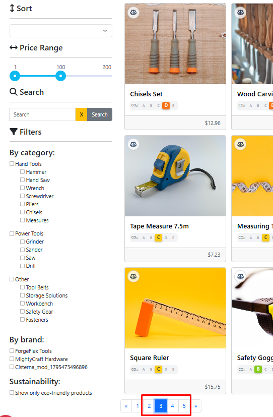 | |
| A funcionalidade de comparar dois produtos entre si funciona corretamente? | No momento do teste não, ao tentar comparar dois produtos o usuário até é redirecionado para a tela de compração, mas ela não carrega | 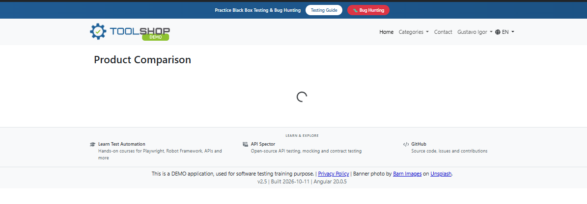 | DEF-006 |
| Ao adicionar produtos ao carrinho, é possível concluir uma compra dando continuidade por ele? | Sim, o sistema permite que o usuário prossiga através do carrinho até a finalização da compra | 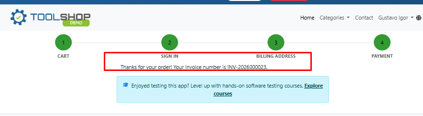 | |

### Defeitos identificados

DEF-006: A tela de comparação de produtos fica carregando e não apresenta as informações dos produtos selecionados durante a tentativa realizada.

### Conclusão da sessão

Os filtros de categoria e preço apresentaram resultados esperados com as opções selecionadas. A paginação do catálogo também funcionou corretamente durante os testes.

Foi possível concluir uma compra a partir do carrinho, passando pelas etapas necessárias até a emissão do número da fatura.

O principal problema encontrado durante a sessão foi na funcionalidade de comparação de produtos, que não apresentou os resultados esperados, permanecendo em carregamento.
