# Casos de Teste Manuais — Practice Software Testing

**Sistema:** https://practicesoftwaretesting.com  
**Executor:** Gustavo Igor  
**Revisora:** Diana da Silva
**Ambiente:** Google Chrome - site público  
**Situação:** Execuçã concluída em 23/11/2026

## 1. Objetivo

Validar manualmente as funcionalidades de cadastro, autenticação, catálogo de produtos e carrinho de compras do Practice Software Testing.

Os testes contemplam cenários positivos e negativos, utilizando técnicas de partição de equivalência, análise de valor-limite e transição de estado.

## 2. Relação dos casos de teste

| ID | Funcionalidade | Cenário | Prioridade |
|---|---|---|---|
| CT-001 | Cadastro | Cadastro com informações válidas | Alta |
| CT-002 | Cadastro | Campos obrigatórios vazios | Alta |
| CT-003 | Cadastro | E-mail já utilizado | Alta |
| CT-004 | Cadastro | E-mail inválido | Média |
| CT-005 | Cadastro | Senha fora dos requisitos | Média |
| CT-006 | Login | Credenciais válidas | Alta |
| CT-007 | Login | Senha incorreta | Alta |
| CT-008 | Login | Campos vazios | Alta |
| CT-009 | Login | E-mail inválido | Média |
| CT-010 | Produtos | Listagem de produtos | Alta |
| CT-011 | Produtos | Pesquisa por produto existente | Média |
| CT-012 | Produtos | Pesquisa por produto inexistente | Média |
| CT-013 | Produtos | Detalhes de produto | Média |
| CT-014 | Carrinho | Adição de produto | Alta |
| CT-015 | Carrinho | Alteração de quantidade | Alta |
| CT-016 | Carrinho | Remoção de produto | Alta |
| CT-017 | Carrinho | Cálculo do subtotal | Alta |
| CT-018 | Carrinho | Carrinho vazio | Média |

## 3. Casos de teste — Cadastro

### CT-001 — Cadastro com informações válidas

**Objetivo:** Verificar se o sistema permite criar uma conta com informações válidas.

**Pré-condições:** Site acessível, usuário não autenticado e e-mail ainda não cadastrado.

**Dados de entrada:** Informações válidas nos campos obrigatórios do formulário e e-mail exclusivo para teste.

**Passos:**
1. Acessar a página de cadastro.
2. Preencher todos os campos obrigatórios com dados válidos.
3. Clicar no botão de cadastro.
4. Observar o comportamento da aplicação.
5. Tentar realizar login com a conta criada.

**Resultado esperado:** O cadastro é concluído e a conta pode ser utilizada para autenticação.

**Resultado obtido:** O cadastro foi concluído e a conta pode ser usada para autenticação normalmente.  
**Status:** Aprovado.  
**Evidência:** 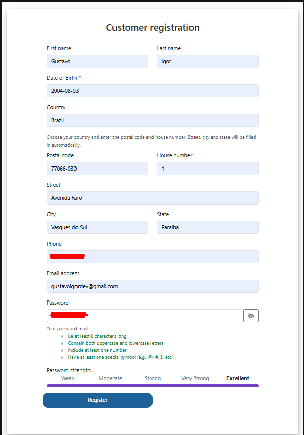 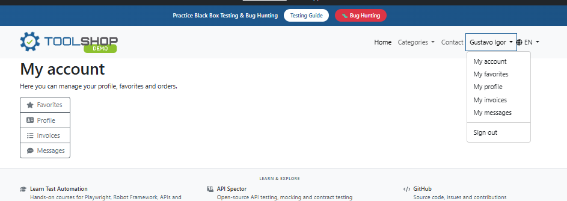

### CT-002 — Cadastro com campos obrigatórios vazios

**Objetivo:** Verificar se o sistema impede o cadastro sem informações obrigatórias.

**Pré-condição:** Página de cadastro aberta.

**Dados de entrada:** Campos obrigatórios vazios.

**Passos:**
1. Acessar a página de cadastro.
2. Manter os campos obrigatórios vazios.
3. Clicar no botão de cadastro.
4. Verificar as mensagens de validação.

**Resultado esperado:** O sistema impede o cadastro e sinaliza os campos obrigatórios não preenchidos.

**Resultado obtido:** O sistema impediu o cadastro e apresentou mensagens de validação para os campos obrigatórios não preenchidos.  
**Status:** Aprovado.  
**Evidência:**

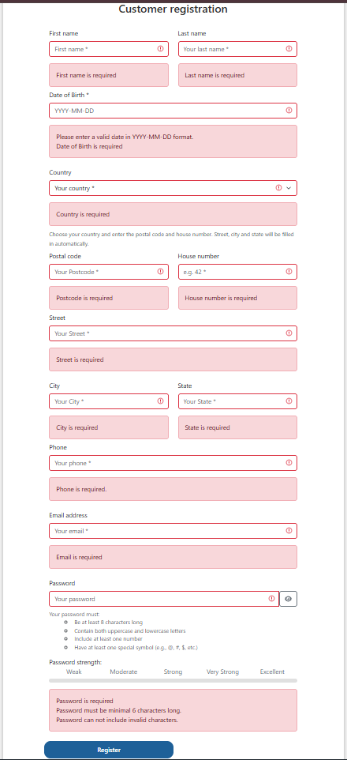

### CT-003 — Cadastro com e-mail já utilizado

**Objetivo:** Verificar se o sistema impede a criação de contas duplicadas.

**Pré-condição:** Existir uma conta cadastrada e funcional.

**Dados de entrada:** Mesmo e-mail de uma conta existente, com demais informações válidas.

**Passos:**
1. Acessar a página de cadastro.
2. Preencher o formulário com dados válidos.
3. Informar o e-mail de uma conta já cadastrada.
4. Enviar o formulário.
5. Observar a resposta.

**Resultado esperado:** O sistema impede a duplicidade e informa que o e-mail já está em uso.

**Resultado obtido:** O sistema impede a criação da conta e informa quee um usuário com o e-mail informado já existe.  
**Status:** Aprovado.  
**Evidência:** 

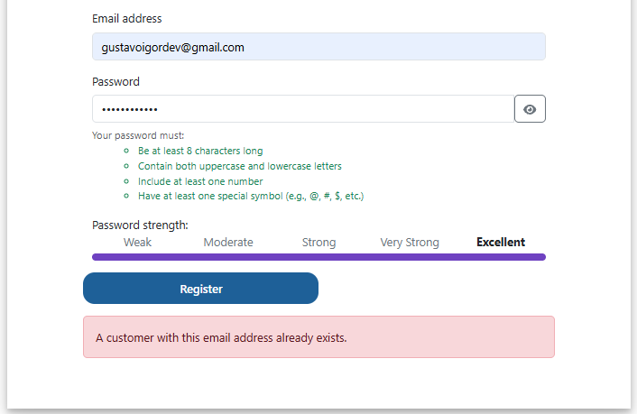

### CT-004 — E-mail em formato inválido

**Objetivo:** Verificar se o formulário valida o formato do e-mail.

**Pré-condição:** Página de cadastro aberta.

**Dados de entrada:** `email-invalido`.

**Passos:**
1. Preencher os demais campos obrigatórios com informações válidas.
2. Informar `email-invalido` no campo de e-mail.
3. Tentar enviar o formulário.
4. Verificar a validação.

**Resultado esperado:** O sistema rejeita o e-mail inválido e impede a conclusão do cadastro.

**Resultado obtido:** O sistema como esperado rejeitou o e-maiil e impediu a conclusão do cadastro.  
**Status:** Aprovado.  
**Evidência:**

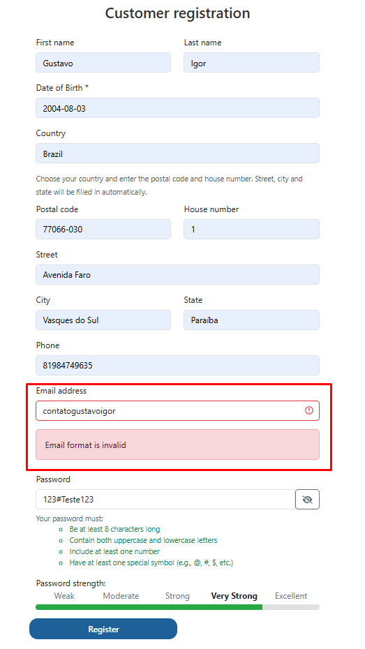

### CT-005 — Senha fora dos requisitos

**Objetivo:** Verificar se o sistema valida as regras de criação de senha.

**Pré-condição:** Formulário de cadastro aberto.

**Dados de entrada:** Senha que viole um requisito informado pelo formulário.

**Passos:**
1. Consultar os requisitos de senha apresentados na interface.
2. Preencher os demais campos obrigatórios.
3. Informar uma senha que viole um requisito.
4. Tentar concluir o cadastro.
5. Verificar a mensagem de validação.

**Resultado esperado:** O sistema impede o cadastro e informa o requisito não atendido.

**Resultado obtido:** O sistema impediu a criação de contas quando a senha informada não atendia aos requisitos obrigatórios. Mas, foram achadas inconsistências nas mensagens de validação e no indicador visual de força da senha. As instruções exigem no mínimo 8 caracteres, enquanto uma mensagem de erro informa o mínimo de 6 caracteres. Além disso, o indicador de força da senha pode permanecer classificado como "Excellent" após a exclusão ou alteração do valor informado. Também foi observado que a falta de um caractere especial obrigatório pode gerar uma mensagem indicando a presença de caracteres inválidos, embora o problema seja a ausência de um caractere exigido.  
**Status:** Reprovado.  
**Evidência:**

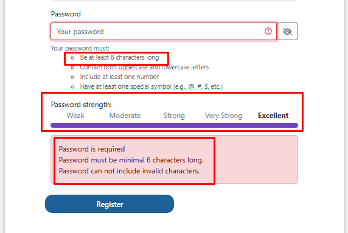

**Defeitos relacionados:** DEF-001, DEF-002 e DEF-003.

## 4. Casos de teste — Login

### CT-006 — Login com credenciais válidas

**Objetivo:** Verificar se um usuário cadastrado consegue autenticar-se.

**Pré-condições:** Existir uma conta ativa e o usuário estar desconectado.

**Dados de entrada:** E-mail e senha válidos da conta de teste.

**Passos:**
1. Acessar a página de login.
2. Informar o e-mail cadastrado.
3. Informar a senha correta.
4. Clicar em Login.
5. Observar o redirecionamento.

**Resultado esperado:** O sistema autentica o usuário e apresenta a área da conta.

**Resultado obtido:** O sistema autenticou o usuário e apresentou corretamente a área da conta.  
**Status:** Aprovado.  
**Evidência:**

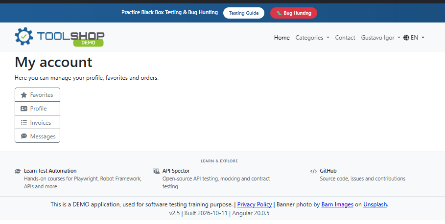

### CT-007 — Login com senha incorreta

**Objetivo:** Verificar se o sistema impede a autenticação com senha inválida.

**Pré-condição:** Página de login disponível.

**Dados de entrada:** E-mail registrado no sistema e senha incorreta.

**Passos:**
1. Acessar a página de login.
2. Informar o e-mail de teste.
3. Informar uma senha incorreta.
4. Clicar em Login.
5. Observar a mensagem apresentada.

**Resultado esperado:** O sistema impede a autenticação e apresenta uma mensagem de erro.

**Resultado obtido:** O sistema assim como esperado impediu a autenticação e apresentou a mensagem de erro "Invalid email or password".  
**Status:** Aprovado.  
**Evidência:**

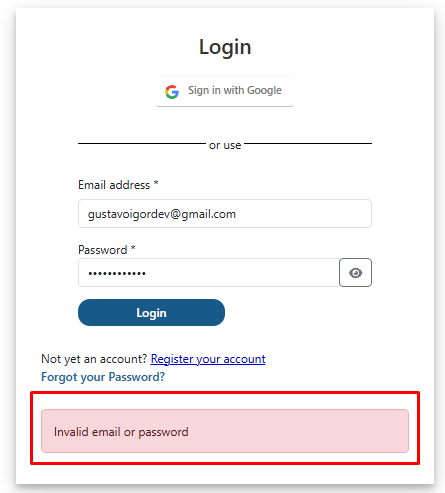

### CT-008 — Login com campos vazios

**Objetivo:** Verificar a validação dos campos obrigatórios no formulário de login.

**Pré-condição:** Página de login aberta.

**Dados de entrada:** E-mail vazio e senha vazia.

**Passos:**
1. Acessar a página de login.
2. Manter o campo de e-mail vazio.
3. Manter o campo de senha vazio.
4. Clicar em Login.
5. Observar as validações apresentadas.

**Resultado esperado:** O sistema impede a autenticação e sinaliza os campos obrigatórios.

**Resultado obtido:** O sistema impediu a autenticação assim como esperado e também indicou os campos obrigatórios.  
**Status:** Aprovado.  
**Evidência:**

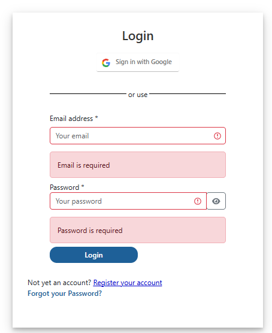

### CT-009 — Login com e-mail inválido

**Objetivo:** Verificar se o formulário rejeita e-mails em formato inválido.

**Pré-condição:** Página de login aberta.

**Dados de entrada:** E-mail inváldo e senha de teste.

**Passos:**
1. Acessar a página de login.
2. Informar `email-invalido` no campo de e-mail.
3. Preencher o campo de senha.
4. Tentar realizar o login.
5. Verificar as mensagens apresentadas.

**Resultado esperado:** O sistema rejeita o formato de e-mail inválido e impede a autenticação.

**Resultado obtido:** O sistema rejeitou o formato de e-mail e exibiu uma mensagem informando que seu formato não válido.  
**Status:** Aprovado.  
**Evidência:**

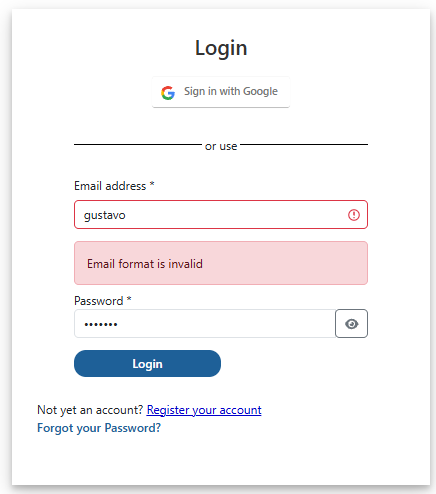

## 5. Casos de teste — Produtos

### CT-010 — Listagem de produtos

**Objetivo:** Verificar se o catálogo apresenta corretamente os produtos disponíveis.

**Pré-condição:** Site acessível.

**Dados de entrada:** Nenhum.

**Passos:**
1. Acessar a página inicial.
2. Aguardar o carregamento do catálogo.
3. Verificar se existem produtos na listagem.
4. Conferir nomes, imagens e preços apresentados.
5. Verificar se os produtos podem ser selecionados.

**Resultado esperado:** O catálogo apresenta produtos com informações básicas visíveis e permite acessar seus detalhes.

**Resultado obtido:** O catálogo como esperado apresntou os produtos com as informações básicas esperadas e permitiu acessar os detalhes de cada produto.  
**Status:** Aprovado.  
**Evidência:**

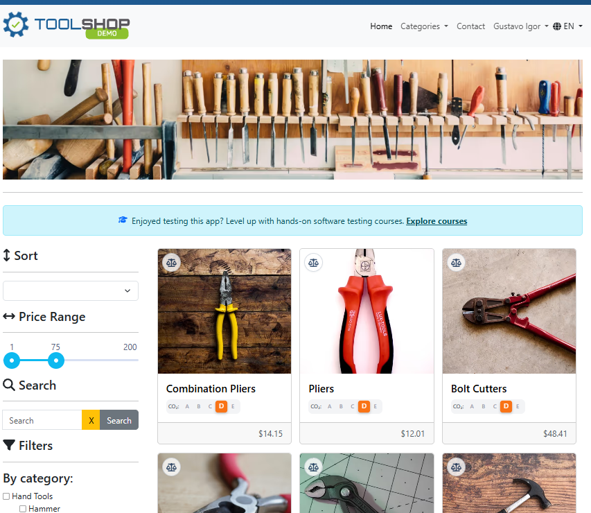

### CT-011 — Pesquisa por produto existente

**Objetivo:** Verificar se o mecanismo de pesquisa encontra produtos cadastrados.

**Pré-condição:** Catálogo disponível.

**Dados de entrada:** Nome de um produto existente, identificado previamente na listagem.

**Passos:**
1. Acessar o catálogo.
2. Identificar o nome de um produto disponível.
3. Informar o nome no campo de pesquisa.
4. Executar a pesquisa.
5. Analisar os resultados retornados.

**Resultado esperado:** O sistema apresenta o produto pesquisado entre os resultados.

**Resultado obtido:** O sistema apresentou exatamente o produto pesquisado nos resultados.  
**Status:** Aprovado.  
**Evidência:**

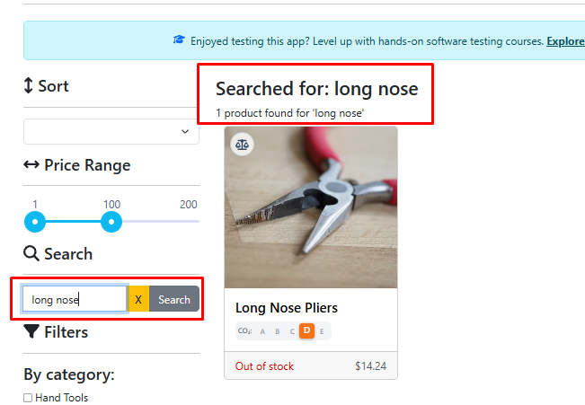

### CT-012 — Pesquisa por produto inexistente

**Objetivo:** Verificar o comportamento do sistema ao pesquisar um produto inexistente.

**Pré-condição:** Catálogo disponível.

**Dados de entrada:** Qualquer produto que não exista no sistema.

**Passos:**
1. Acessar a página de produtos.
2. Localizar o campo de pesquisa.
3. Informar um produto inexistente.
4. Executar a pesquisa.
5. Observar os resultados apresentados.

**Resultado esperado:** O sistema não apresenta produtos incompatíveis com o termo e representa adequadamente a ausência de resultados.

**Resultado obtido:** O sistema não apresentou o produto pesquisado, além de não apresentar nenhum produto por não ter termos equivalentes.  
**Status:** Aprovado.  
**Evidência:** 

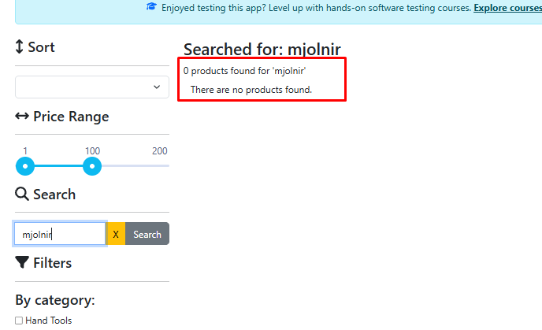

### CT-013 — Visualização dos detalhes de um produto

**Objetivo:** Verificar se as informações de um produto são apresentadas corretamente.

**Pré-condição:** Existir pelo menos um produto disponível no catálogo.

**Dados de entrada:** Produto selecionado na listagem.

**Passos:**
1. Acessar o catálogo.
2. Selecionar um produto.
3. Abrir sua página de detalhes.
4. Verificar o nome e o preço apresentados.
5. Comparar as informações com aquelas exibidas na listagem.
6. Verificar as demais informações disponíveis na página.

**Resultado esperado:** A página apresenta os detalhes do produto selecionado, mantendo coerência com as informações do catálogo.

**Resultado obtido:** Ao clicar no produto, a página apresenta todos os detalhes do produto selecionado, mantendo as informações que já eram apresentadas no católogo fieis e exibindo também novos detalhes.  
**Status:** Aprovado.  
**Evidência:**

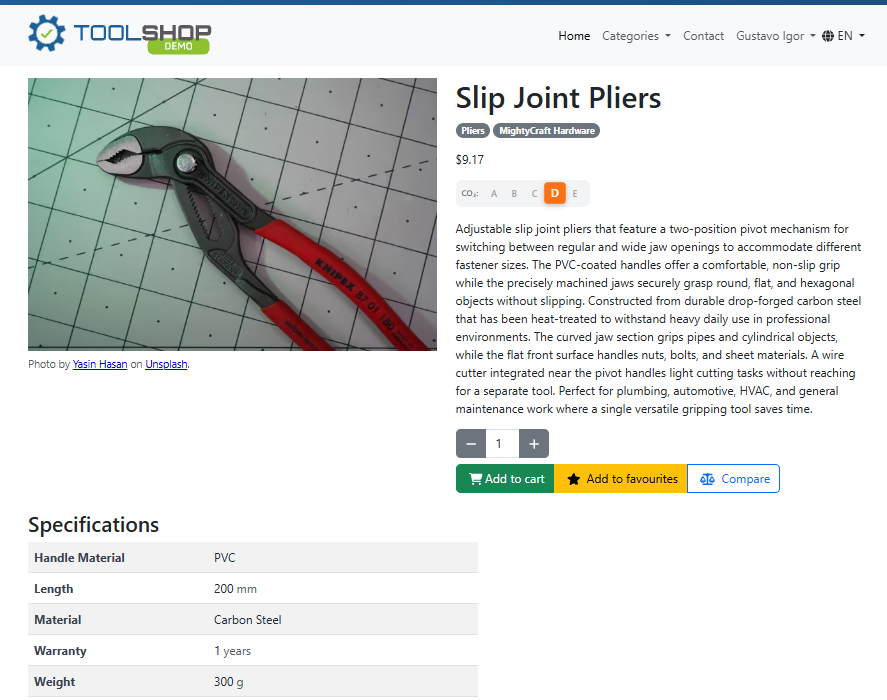

## 6. Casos de teste — Carrinho de compras

### CT-014 — Adição de produto ao carrinho

**Objetivo:** Verificar se um produto pode ser adicionado ao carrinho de compras.

**Pré-condições:** Catálogo acessível e carrinho inicialmente vazio.

**Dados de entrada:** Produto disponível, quantidade igual a 1.

**Passos:**
1. Acessar o catálogo.
2. Selecionar um produto.
3. Definir a quantidade igual a 1.
4. Clicar em adicionar ao carrinho.
5. Abrir a página do carrinho.
6. Verificar o produto adicionado.

**Resultado esperado:** O produto aparece no carrinho com nome, quantidade e preço correspondentes.

**Resultado obtido:** O produto foi adicionado com sucesso ao carrinho e apreenta seu nome, quantidade e preço corretamente.  
**Status:** Aprovado.  
**Evidência:**

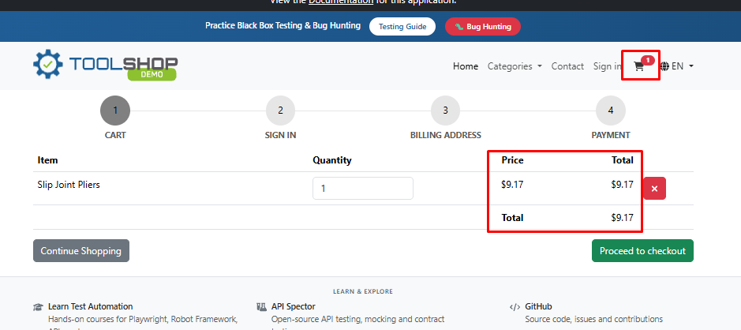

### CT-015 — Alteração da quantidade no carrinho

**Objetivo:** Verificar se a quantidade de um produto pode ser modificada.

**Pré-condição:** Existir um produto no carrinho com quantidade igual a 1.

**Dados de entrada:** Alteração da quantidade de 1 para 2.

**Passos:**
1. Abrir o carrinho de compras.
2. Identificar o produto adicionado.
3. Localizar o controle de quantidade.
4. Alterar a quantidade de 1 para 2.
5. Verificar a atualização da quantidade.
6. Conferir o valor apresentado para o item.

**Resultado esperado:** O carrinho apresenta quantidade igual a 2 e recalcula corretamente o valor correspondente.

**Resultado obtido:** O carrinho passou a apresentar quantiade igual a 2 e recalculou o valor corretamente.  
**Status:** Aprovado.  
**Evidência:**

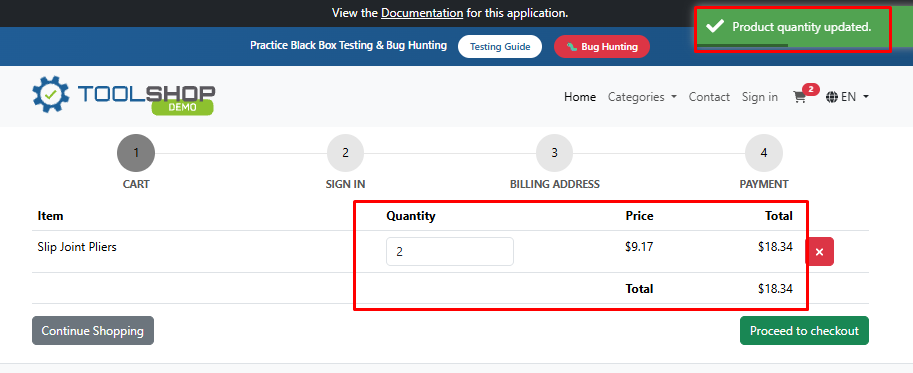

### CT-016 — Remoção de produto do carrinho

**Objetivo:** Verificar se um produto pode ser removido do carrinho.

**Pré-condição:** Existir pelo menos um produto no carrinho.

**Dados de entrada:** Produto adicionado anteriormente.

**Passos:**
1. Acessar a página do carrinho.
2. Identificar o produto que será removido.
3. Acionar a opção de remoção.
4. Aguardar a atualização do carrinho.
5. Verificar se o produto continua aparecendo.
6. Conferir os valores restantes.

**Resultado esperado:** O produto é removido e os valores do carrinho são atualizados corretamente.

**Resultado obtido:** O produto foi removido e o carrinho passou a exibir a mensagem de carrinho vazio(obs: ao realizar o teste com dois produtos diferentes adicionados e removendo apenas um, o total foi recalculado corretamente).  
**Status:** Aprovado.  
**Evidência:**

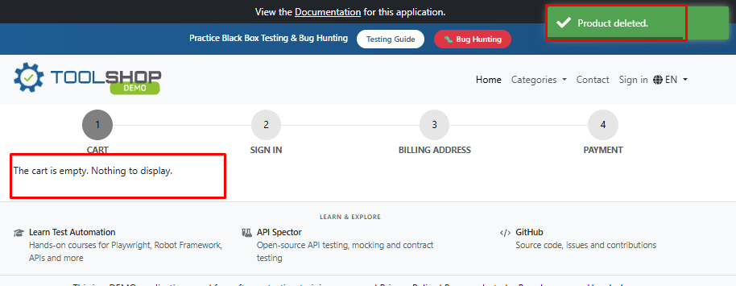

### CT-017 — Validação do cálculo do subtotal

**Objetivo:** Verificar se o subtotal de um produto corresponde ao preço unitário multiplicado pela quantidade.

**Pré-condição:** Produto disponível com preço unitário visível.

**Dados de entrada:** Produto com quantidade unitária igual a 5.

**Passos:**
1. Selecionar um produto no catálogo.
2. Anotar seu preço unitário.
3. Adicionar cinco unidades ao carrinho.
4. Abrir o carrinho.
5. Multiplicar manualmente o preço unitário por 5.
6. Comparar o valor calculado com o subtotal exibido.

**Resultado esperado:** O subtotal corresponde ao preço unitário multiplicado pela quantidade, respeitando as regras de arredondamento da aplicação.

**Resultado obtido:** O subtotal correspondeu corratemente ao preço unitário multiplicado pela quantidade.  
**Status:** Aprovado.  
**Evidência:**

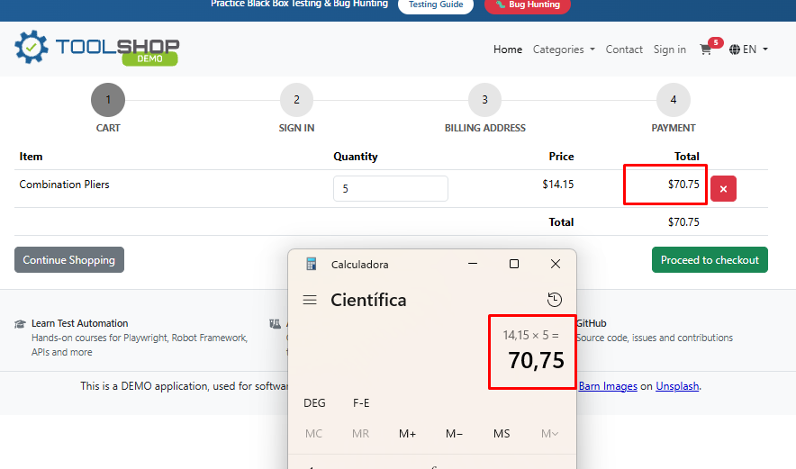

### CT-018 — Verificação do carrinho vazio

**Objetivo:** Verificar se o carrinho apresenta corretamente seu estado quando não possui produtos.

**Pré-condição:** Carrinho acessível.

**Dados de entrada:** Nenhum.

**Passos:**
1. Acessar o carrinho de compras.
2. Remover todos os produtos existentes, se necessário.
3. Aguardar a atualização da página.
4. Verificar a ausência de produtos.
5. Conferir os valores apresentados.
6. Observar a indicação de carrinho vazio.

**Resultado esperado:** O carrinho não apresenta produtos nem valores indevidos e informa adequadamente que está vazio.

**Resultado obtido:** Como esperado o carrinho não apresentou nenhum produto ou valor, além de informar que está vazio.  
**Status:** Aprovado.  
**Evidência:**

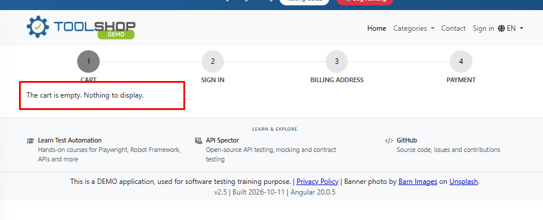

## 7. Registro de execução

| ID | Status | Resultado obtido |
|---|---|---|
| CT-001 | Aprovado | O cadastro foi concluído e a conta pode ser usada para autenticação normalmente | 
| CT-002 | Aprovado | O sistema impediu o cadastro e apresentou mensagens de validação para os campos obrigatórios não preenchidos |
| CT-003 | Aprovado | O sistema impede a criação da conta e informa quee um usuário com o e-mail informado já existe |
| CT-004 | Aprovado | O sistema como esperado rejeitou o e-maiil e impediu a conclusão do cadastro | 
| CT-005 | Reprovado | O sistema impediu a criação de contas quando a senha informada não atendia aos requisitos obrigatórios. Mas, foram achadas inconsistências nas mensagens de validação e no indicador visual de força da senha. As instruções exigem no mínimo 8 caracteres, enquanto uma mensagem de erro informa o mínimo de 6 caracteres. Além disso, o indicador de força da senha pode permanecer classificado como "Excellent" após a exclusão ou alteração do valor informado. Também foi observado que a falta de um caractere especial obrigatório pode gerar uma mensagem indicando a presença de caracteres inválidos, embora o problema seja a ausência de um caractere exigido | 
| CT-006 | Aprovado | O sistema autenticou o usuário e apresentou corretamente a área da conta |
| CT-007 | Aprovado | O sistema assim como esperado impediu a autenticação e apresentou a mensagem de erro "Invalid email or password" | 
| CT-008 | Aprovado | O sistema impediu a autenticação assim como esperado e também indicou os campos obrigatórios | 
| CT-009 | Aprovado | O sistema rejeitou o formato de e-mail e exibiu uma mensagem informando que seu formato não válido | 
| CT-010 | Aprovado | O catálogo como esperado apresntou os produtos com as informações básicas esperadas e permitiu acessar os detalhes de cada produto |
| CT-011 | Aprovado | O sistema apresentou exatamente o produto pesquisado nos resultados |
| CT-012 | Aprovado | O sistema não apresentou o produto pesquisado, além de não apresentar nenhum produto por não ter termos equivalentes | 
| CT-013 | Aprovado | Ao clicar no produto, a página apresenta todos os detalhes do produto selecionado, mantendo as informações que já eram apresentadas no católogo fieis e exibindo também novos detalhes |
| CT-014 | Aprovado | O produto foi adicionado com sucesso ao carrinho e apreenta seu nome, quantidade e preço corretamente | 
| CT-015 | Aprovado | O carrinho passou a apresentar quantiade igual a 2 e recalculou o valor corretamente | 
| CT-016 | Aprovado | O produto foi removido e o carrinho passou a exibir a mensagem de carrinho vazio(obs: ao realizar o teste com dois produtos diferentes adicionados e removendo apenas um, o total foi recalculado corretamente) | 
| CT-017 | Aprovado | O subtotal correspondeu corratemente ao preço unitário multiplicado pela quantidade | 
| CT-018 | Aprovado | Como esperado o carrinho não apresentou nenhum produto ou valor, além de informar que está vazio |

## 8. Critérios de classificação

**Aprovado:** O resultado obtido corresponde ao resultado esperado.

**Reprovado:** O resultado obtido apresenta divergência em relação ao esperado.

**Bloqueado:** Uma condição do ambiente ou uma dependência impede a execução.

**Não executado:** O caso ainda não foi realizado.
